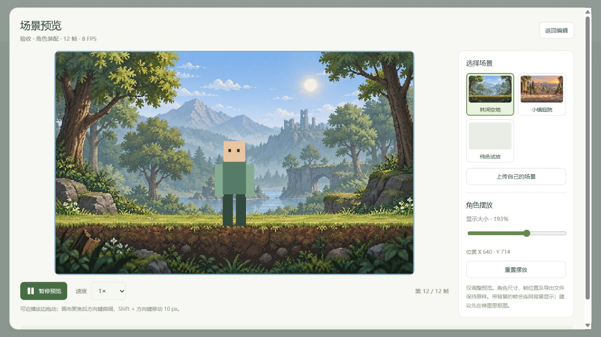

# Frame Studio

[](https://github.com/charolettebradford1361985svo-bit/frame-studio/actions/workflows/ci.yml)
[](LICENSE)

**面向独立游戏开发者的本地 2D 素材工作台：裁帧、校准、修图、预览，再导出。**

A local-first 2D game asset workbench for sprite-sheet cropping, frame alignment, pixel cleanup, character assembly, scene previews and PNG/JSON export. Core editing works without an API key or a paid image/video service. The interface is currently primarily Chinese.

**Status: early public preview.** Built iteratively with AI coding assistance and manual validation. Optional models and paid providers are separate integrations, not bundled services. Contributions and real-world feedback are welcome.



*场景预览使用程序绘制的测试角色；背景为已标注来源的 AI 辅助生成素材。*

## 为什么做这个

AI 生成的角色动作拼图经常出现位置漂移、画布大小不一、透明边缘脏色，直接放进游戏就会抖动。Frame Studio 让你人工检查并用确定性工具整理这些素材，减少反复付费生成视频的需要。

**推荐流程：导入拼图 → 确认裁框 → 统一画布/锚点 → 修整 → 在场景中循环检查 → 导出。**

## 借鉴与致谢 / Acknowledgements

早期视频抽帧、背景处理、预览与导出工作流参考 [VideoToSprite](https://github.com/siloebb/video-to-spritesheet)。感谢上游项目；Frame Studio 不是其官方版本。

当前抽帧采用浏览器视频解码和 Canvas 实现，没有把上游的 Python/FFmpeg 抽帧模块作为运行依赖。上游使用 Apache-2.0，本仓库自有代码使用 MIT；具体参考范围、实现对照及许可证链接见 [第三方来源说明](THIRD_PARTY_NOTICES.md#videotosprite早期工作流参考)。

## 已有功能

| 入口 | 可以做什么 |
| --- | --- |
| 动画工作台 | 自定义/统一裁框，6/12/24 帧网格及最多 36 帧自定义布局；拖动与缩放后明确确认；共享画布和锚点、可拖参考线、前/后/固定参考帧、画笔/橡皮擦、局部对齐与色彩统一、撤销/重做、逐帧时长及播放方向 |
| 场景预览 | 当前动画直接进入场景；选择内置背景或上传背景，拖动和缩放角色，循环播放及调速；不改变原始帧和导出尺寸 |
| 角色装配 | 手动拆分图片部件、父子关节、旋转中心、关键姿势和关节插值；没有自动识别全部肢体或网格蒙皮 |
| 场景与碰撞 | 将角色试放到背景，逐帧标记框和动作事件，保存/导出 |
| 地形工作台 | 图块编辑、地图、3×3 平铺预览和边缘差异检查；不自动生成或修补地形 |
| 共用素材库 | 本机 IndexedDB、搜索、恢复原工作台、跨工作台导入、完整项目 ZIP 备份与恢复 |
| 视频抽帧 | 导入本地视频或内置示例，按时间范围取 8/12/16/24/36 帧；保留比例，不自动放大 |
| 共用图片工具 | 色键抠图、边缘清理、确定性清晰处理与规格检查；可选本地 AI 抠图/高清/补帧 |

局部自动对齐是模板匹配平移；传统补帧只平移起始图，不能凭空产生肢体姿势。RIFE 是另一条需要安装模型的实验性路径，像素画、遮挡和大幅动作仍需人工检查。

## 快速开始 / Quick start

需要 **Node.js 22.9+** 和 npm；推荐 Node.js 24。使用支持 Canvas、IndexedDB、`createImageBitmap` 和 `<dialog>` 的现代桌面浏览器。完整本地体验目前以 Windows 为主；核心前端不依赖 Python。

```sh
git clone https://github.com/charolettebradford1361985svo-bit/frame-studio.git
cd frame-studio
npm ci
npm run dev -- --host 127.0.0.1 --port 4173 --strictPort
```

打开 **http://127.0.0.1:4173/**。该命令启动 Vite 网页及绑定本机 `127.0.0.1:4174` 的 Node API。停止终端任务即可停止服务。

无需复制 `.env` 或安装模型即可使用普通裁剪、校准、修图、素材库与导出。没有自己的素材时，可从首页试用花朵示例视频；`tests/fixtures/` 也有小型算法测试拼图。

Windows 可在安装依赖后运行：

```powershell
powershell -NoProfile -File scripts/launch-desktop.ps1
```

启动脚本使用项目自身位置，后台日志保存在 `.logs/`，重复运行会复用已启动的服务。它不会替新用户自动创建桌面快捷方式。

## 先体验动画工作台

1. 从首页进入“动画工作台”，上传序列拼图。
2. 选择网格或手动画矩形；拖动、拉角调整后按 **Space** 或点击确认，才会开始下一帧。**Esc** 取消待确认框。
3. 裁出帧，在“对齐”中设置共享画布和脚底/身体锚点，拖动黄/蓝/红参考线对比位置。
4. “修图”中可画笔、擦除、去底色和局部处理。图片自身已经画变形时，平移对齐不能修好造型。
5. 点击左侧“场景预览”，把角色放进场景循环查看。预览缩放与场景摆放不改变实际输出尺寸。
6. “导出”中选择 PNG 图片集、等格精灵图或游戏图集 + JSON。需要稍后继续编辑时，先保存到素材库。

## 保存与导出

- **完整项目备份**：保存到素材库 → 在素材库“导出 ZIP”。恢复时使用“导入项目 ZIP”，新增副本后打开原工作台。支持 `frame-studio-project` v1。
- **游戏资源导出**：动画 PNG 图片集使用 `frame-001.png` 等名称；视频抽帧图片集使用 `frame_0001.png` 等名称。两者包含对应的 `frames.json`；游戏图集还保存裁剪偏移、共享锚点及独立时长。
- 图集 JSON 是项目自己的格式，尚未逐一验证所有游戏引擎的直接导入。游戏资源包不是完整项目备份。
- 参考线、洋葱皮和场景预览背景不进入动画帧导出。
- 素材库按 **浏览器 + 网站地址（包含端口）** 隔离。清除网站数据、换浏览器或端口不会自动迁移作品，请导出完整项目 ZIP。
- 未保存时会请求浏览器的离开提示；手机、强制关闭等情况不保证弹窗。这不是自动保存或云端备份。

## 可选 AI 与联网行为

| 功能 | 需要什么 | 说明 |
| --- | --- | --- |
| 本地 AI 抠图 | Python + `requirements.txt` + rembg `u2netp` | 通过本机 API 运行；首次模型下载需联网 |
| 本地 AI 高清 / RIFE 补帧 | Windows ncnn 便携包、模型、Vulkan 和真实验证 | 实验性适配；不捆绑二进制/权重，不提供一键安装 |
| 图生视频 | Runway API 密钥及额度 | 主动调用时上传选定图片和提示词，可能收费 |
| 文字助手 | DeepSeek API 密钥及可用模型 | 仅用于提示词、命名和动作规划；主动调用时联网，可能收费 |

安装细节及限制见 [可选本地 AI](docs/local-ai.md)。**不安装大型扩散模型或语言模型，不默认下载本地高清/补帧模型。**

使用云服务时，把 `.env.example` 复制为 `.env`，填写自己的密钥后重启服务：

```dotenv
RUNWAYML_API_SECRET=
DEEPSEEK_API_KEY=
# 如需覆盖默认值，填写你的账号实际可用的模型：
# DEEPSEEK_MODEL=your-available-model
```

不要把 `.env`、API 密钥、私人图片或项目备份提交到 GitHub。缺少密钥或模型时对应功能会明确提示不可用，不用示例冒充生成结果。

## 验证 / Validation

```sh
npm test
npm run build
npm run test:sites
```

CI 在 Windows 和 Linux 上运行 Node 测试、前端构建与静态托管适配检查。测试覆盖裁剪越界、共享画布/锚点、透明处理、局部颜色统一、历史记录、时间轴、素材库、ZIP 校验、路由与接口错误等。

**测试边界：** API 流程使用测试替身，不表示真实付费服务已通过验收；CI 不安装可选 AI 模型，也不替代真实浏览器/GPU 验证。前端构建位于 `dist/client/`；现有 Sites 打包格式予以保留，但静态托管不会部署本机 Node/Python API。当前没有公网多用户模式、云端素材同步或 Canva 内连。

## 参与贡献

- [贡献说明](CONTRIBUTING.md) · [路线图](ROADMAP.md) · [安全说明](SECURITY.md)
- [项目结构](docs/architecture.md) · [第三方与素材来源](THIRD_PARTY_NOTICES.md)
- [反馈问题](https://github.com/charolettebradford1361985svo-bit/frame-studio/issues)

项目刚开始公开维护，欢迎真实试用反馈和小范围 PR。请用允许公开的最小素材复现问题。

## License

原创代码与文档采用 [MIT](LICENSE)。第三方依赖、可选模型、AI 辅助生成媒体和用户导入素材的范围见 [THIRD_PARTY_NOTICES.md](THIRD_PARTY_NOTICES.md)。
